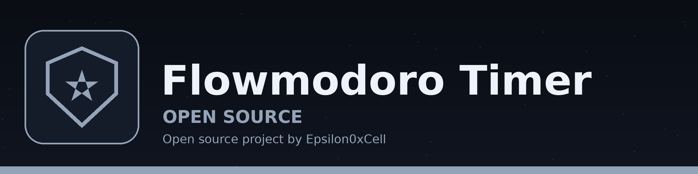

# Flowmodoro-Timer
Custom flowmodoro website utilizing YouTube study spaces to create ambience.

## Implementation

This project is complete and runnable. Run it: open `index.html` in any browser (or serve the folder with `python3 -m http.server`). Focus counts up; stopping banks a break worth 1/5 of your focus time. Paste any YouTube study-space URL to load it as ambience.
